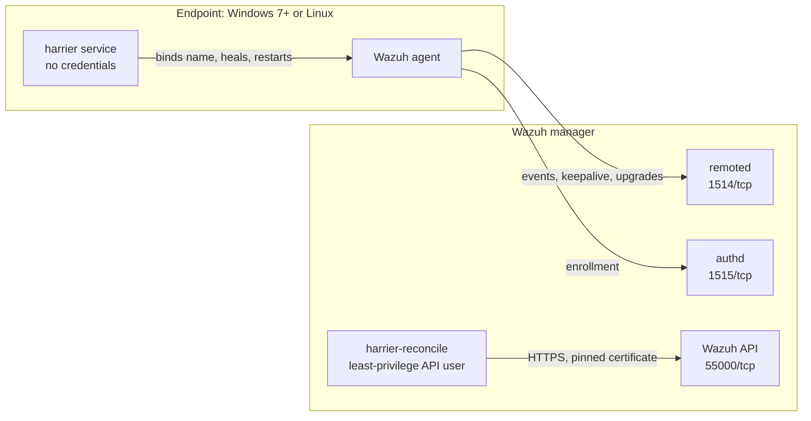

<p align="center">
  
</p>

<h3 align="center">The fleet guardian for Wazuh</h3>

<p align="center">
  Hardware-bound agent identity · self-healing agents · an inventory you can trust<br>
  One tiny, dependency-free binary for Linux and Windows 7+.
</p>

<p align="center">
  <a href="https://github.com/omidiyanto/harrier/actions/workflows/ci.yml"></a>
  
  
  
  
</p>

<p align="center"><a href="https://omidiyanto.github.io/harrier/"><b>Documentation site</b></a></p>

---

A harrier hunts by *quartering*: low, steady sweeps over the same field until
nothing moves that shouldn't. **Harrier** does that for your Wazuh fleet.
Every five minutes it checks each agent, fixes what drifted, revives what
hung, and keeps the inventory on your manager clean: one record per machine,
no ghosts, no twins.

## Why

Wazuh identifies agents by name, and real fleets are messy:

- two laptops ship with the **same hostname** and keep replacing each other;
- a machine is **re-imaged, cloned or renamed** and comes back as a second agent;
- agents **hang or get stopped** and nobody notices until an incident;
- **ghost records** pile up, inflating vulnerability counts and hiding real
  coverage gaps.

Harrier fixes all of these at the root: the agent name is tied to the
**hardware**, the endpoint **heals itself**, and the server **reconciles**
the inventory. Endpoints never hold a single Wazuh credential.

## Quick start

**Linux** (x86_64 / i686, root):

```sh
curl -fsSL https://github.com/omidiyanto/harrier/releases/latest/download/install.sh \
  | sudo sh -s -- --manager 10.0.0.5 --group linux --wazuh-version 4.14.9
```

**Windows** (x64 / x86, elevated PowerShell 3.0+; Windows 7 / 2008 R2 need
WMF 5.1):

```powershell
[Net.ServicePointManager]::SecurityProtocol = 3072; & ([scriptblock]::Create((New-Object Net.WebClient).DownloadString('https://github.com/omidiyanto/harrier/releases/latest/download/install.ps1'))) -Manager 10.0.0.5 -Group windows -WazuhVersion 4.14.9
```

That one command downloads Harrier (verified against `SHA256SUMS`) and the
official Wazuh agent from `packages.wazuh.com`, installs the agent under its
hardware-bound name and starts the `harrier` service. Run it again to
upgrade Harrier or the agent; with nothing new, it changes nothing.

- `--wazuh-version`: Wazuh agent **4.x up to 4.14** (5.x is untested and
  refused), not newer than the manager. It can be left out where the agent
  is already installed.
- Enrollment password: `sudo WAZUH_REGISTRATION_PASSWORD=... sh -s -- ...` on
  Linux, `-RegistrationPassword` on Windows.
- **No internet on endpoints, or a private repository?** Put the release
  files (`install.sh`, `install.ps1`, `harrier-*`, `SHA256SUMS`) on an internal
  HTTPS server or share and point the installer at it with
  `HARRIER_BASE_URL=...` (Linux) or `-BaseUrl ...` (Windows, `file://` works
  too). Mirror `packages.wazuh.com` the same way with `WAZUH_PACKAGES_URL` /
  `-WazuhPackagesUrl`. Never put a GitHub token on endpoints.

**Server** (on the Wazuh manager, root):

```sh
sudo HARRIER_API_PASSWORD='...' ./harrier-linux-x86_64 setup-server \
  --api-url https://127.0.0.1:55000 --api-user harrier
```

The first run is a dry-run that shows exactly what would change; from then
on the `harrier-reconcile` service keeps the inventory clean every hour.
[Server setup](#server-setup) covers the API user and TLS options.

## How it works



| Connection | Port | Direction |
|---|---|---|
| Agent to manager: events, keepalive, WPK upgrades | 1514/tcp | endpoint → manager |
| Agent enrollment | 1515/tcp | endpoint → manager |
| `harrier-reconcile` to the Wazuh API | 55000/tcp | localhost on the manager |
| Anything into endpoints | none | Harrier opens no ports |

The endpoint service only talks to the local agent. While the agent is
healthy it uses no network at all; it probes 1514/tcp only to tell a dead
agent from a manager outage.

## The patrol

Every pass, the endpoint service walks this playbook. The letter shows up in
the logs.

| | Situation | Harrier's move |
|---|---|---|
| **A** | Healthy | Nothing. |
| **B** | Manager unreachable | Stands by; keys are never touched, the agent buffers events. |
| **C** | Agent deleted on the server | The agent re-enrolls by itself; if a restart has not helped within an hour, Harrier drops the key and re-enrolls. |
| **D** | Disk cloned or moved to other hardware | New hardware name, local identity dropped, re-enroll. The original machine's agent is never touched. |
| **E** | Hostname changed | Re-enrolls under the new name; the server removes the old record only **after** the new one is active. |
| **F** | `ossec.conf` name or label tampered, key missing | Repairs the config and restarts; a missing key re-enrolls under the same name. |
| **G** | Agent stopped, disabled or hung | Restarts it after 10 minutes, with a 30 minute backoff; on Windows the service manager also restarts a crashed agent. |
| **H** | Group drift | The server is the source of truth: groups move to the surviving record before an old one is deleted. |
| **I** | Every network card replaced | New hardware id, same firmware id: re-enrolls, and the server ties the new record to the old one, carries its groups and removes it. |

Every re-enrollment backs up `ossec.conf` and `client.keys` (`*.harrier-bak`)
and clears the agent's local FIM, SCA and syscollector databases so the new
agent id sends a full inventory. Re-enrollment happens at most once an hour,
so an identity can never flap. Each action is written to the journal (Linux)
or the Application event log (Windows), which the Wazuh agent already ships
to your SIEM.

## Hardware-bound identity

The agent name is `<HOSTNAME>-<hwid>-<fwid>`, for example
`FINANCE-07-3fa94c1d02be-77a1c0de9f31`, with 12 hex digits (SHA-256) each:

| | Hashed from | Changes when |
|---|---|---|
| `hwid` | SMBIOS system UUID + BIOS serial + burned-in MACs of physical NICs | the disk lands on other hardware, or every NIC is replaced |
| `fwid` | SMBIOS system UUID + BIOS serial | the disk lands on other hardware |

The `hwid` is the identity; the `fwid` is the tag that stays with the
machine when all its network cards change, so the server can tie the old
record to the new one. The full `hwid` is also added as the agent label
`harrier_hwid`, so it travels with every alert.

It is built to stay stable on real hardware:

- only **burned-in** MACs count, so Wi-Fi MAC randomization and spoofing never
  change the identity;
- USB adapters and docks, virtual (VirtualBox, Hyper-V, Docker), VPN/TAP,
  Bluetooth and locally administered interfaces are ignored; VM guest NICs
  are kept;
- placeholder firmware values (`To be filled by O.E.M.`, all-zero UUIDs) are
  ignored;
- a NIC that disappears (adapter disabled, driver still loading) keeps the
  identity as long as UUID and serial match and one MAC is still shared. A
  cloned disk on different hardware does not.

Without a usable UUID **and** serial the `fwid` is the `hwid` itself; the OS
machine id is used only when the firmware exposes nothing at all. A VM
cloned without a new BIOS UUID shares its `fwid` with the original: both stay
untouched and the server logs a warning.

## Inventory hygiene

`harrier-reconcile` runs next to the manager and is the only component that
talks to the Wazuh API. Each hour it plans, then applies:

- **Twins**: records with the same `fwid` (rename, re-image, lost key, new
  NICs). The best one stays (active first, then most recent keepalive, then
  newest id); the inactive rest go.
- **Legacy names**: an inactive plain-hostname record whose machine is now
  active under its hardware-bound name.
- **Stale agents**: disconnected for 30 days or never connected for 7 days
  (both configurable, `0` turns them off).

Safety rails: an **active agent is never deleted**, two active agents with
the same `fwid` only raise a warning, groups are carried over before
anything is removed, a run that would delete more than `max_delete` agents
(default 50) is refused as a whole, and `protect_groups` shields agents from
stale cleanup. `harrier reconcile` without `--apply` prints the plan and
changes nothing.

## Server setup

1. Create a least-privilege API user (dashboard **Security**, or the API)
   with `agent:read`, `agent:delete` and `agent:modify_group` on
   `agent:id:*`, plus `group:modify_assignments` on `group:id:*`, for
   example a user named `harrier`.
2. Run `setup-server` as shown in [Quick start](#quick-start). TLS options,
   safest first:
   - **default on the manager**: the API certificate key is pinned
     automatically from `/var/ossec/api/configuration/ssl/server.crt`;
   - `--api-cert FILE` or `--api-pin sha256//...`: pin the (self-signed)
     certificate of a remote API;
   - `--api-ca-file FILE`: regular CA validation;
   - `--api-insecure`: no verification, for labs only. Anyone who can
     intercept the traffic can steal the API password, so every run logs a
     warning. Pinning works with self-signed certificates too.
3. Recommended on the manager: because Harrier names are unique per machine,
   a short replacement window is safe and brings a reinstalled machine back
   in minutes instead of an hour.

   ```xml
   <auth>
     <force>
       <enabled>yes</enabled>
       <key_mismatch>yes</key_mismatch>
       <disconnected_time enabled="yes">10m</disconnected_time>
       <after_registration_time>1h</after_registration_time>
     </force>
   </auth>
   ```

## Offline and managed deployment

For GPO, Intune, SCCM or Ansible, copy the binary and the agent package and
run, elevated:

```bat
set WAZUH_REGISTRATION_PASSWORD=<enrollment password, if used>
harrier-windows-x86_64.exe setup --manager 10.0.0.5 --group windows ^
  --package \\fileserver\wazuh\wazuh-agent-4.14.9-1.msi
```

```sh
sudo WAZUH_REGISTRATION_PASSWORD='...' ./harrier-linux-x86_64 setup \
  --manager 10.0.0.5 --group linux --package ./wazuh-agent_4.14.9-1_amd64.deb
```

`setup` installs Harrier into its fixed location, so it can run from
anywhere, and every run converges to the same state:

- agent missing: installs it, already under its hardware-bound name;
- package differs from the last one Harrier installed: upgrades in place,
  keeping the agent's configuration;
- same package: nothing to do.

The package is kept with its SHA-256 pinned (`--package-sha256` checks it up
front), so Harrier can reinstall an agent someone removed. Settings are saved
only after the installer succeeds, so a failed run is retried by running the
same command again. The enrollment password goes to `authd.pass`, never onto
a command line.

## Reference

### Commands

| Command | Where | What |
|---|---|---|
| `setup` | endpoint | install or upgrade Harrier and the agent, bind identity, run the `harrier` service |
| `check` | endpoint | one self-healing pass now (the service runs one every 5 minutes) |
| `status` | endpoint | hardware identity, enrolled name, agent state, manager reachability |
| `name` | endpoint | print the hardware-bound agent name |
| `uninstall` | both | remove the Harrier services (the agent stays) |
| `setup-server` | server | store API settings (mode 600), verify, run the `harrier-reconcile` service |
| `reconcile [--apply]` | server | plan, or with `--apply` execute, the inventory cleanup |

### Services

| | Linux | Windows |
|---|---|---|
| Endpoint | systemd `harrier.service`, `Restart=always` | service `harrier`, LocalSystem, delayed auto-start, restart on failure |
| Server | systemd `harrier-reconcile.service` | service `harrier-reconcile`, if run on Windows |
| Logs | `journalctl -u harrier` | Application event log, source `harrier` |

Both run `harrier daemon check|reconcile`: one pass, then sleep for
`interval_minutes` (5 or 60), re-reading the config every pass so edits
apply without a restart. A repeated identical error is logged once, not on
every pass. Linux hosts without systemd can run `/opt/harrier/harrier daemon
check` under their own init system.

### Files

| | Linux | Windows |
|---|---|---|
| Binary | `/opt/harrier/harrier` | `%ProgramFiles%\Harrier\harrier.exe` |
| Endpoint config | `/etc/harrier/harrier.conf` | `%ProgramFiles%\Harrier\harrier.conf` |
| Server config (mode 600) | `/etc/harrier/server.conf` | `%ProgramFiles%\Harrier\server.conf` |
| State, agent package | `/var/lib/harrier/` | `%ProgramFiles%\Harrier\` |

Endpoint keys: `manager`, `group`, `package`, `package_sha256`, `agent_dir`,
`interval_minutes` (5), `grace_minutes` (10), `backoff_minutes` (30).

Server keys: `api_url`, `api_user`, `api_password`, `api_ca_file`, `api_pin`,
`api_insecure` (false), `interval_minutes` (60), `disconnected_days` (30),
`never_connected_days` (7), `max_delete` (50), `protect_groups` (comma
separated).

## Security model

Harrier runs as root or SYSTEM, so everything it reads or executes must be
writable by administrators only.

- **No credentials on endpoints.** Only `harrier-reconcile` talks to the API,
  passing password and token to `curl` on stdin, never on a command line.
- **Trusted locations only.** On Linux the config must be owned by root and
  not writable by others (`server.conf` mode 600, foreign symlinks rejected)
  and `/opt/harrier` must not be writable by others. On Windows, config, state
  and binary must live in `%ProgramFiles%\Harrier`; a `--config` elsewhere is
  refused.
- **Secrets are never briefly exposed**: files are created with their final
  permissions in a temp file, then renamed into place.
- **No shell, fixed tool paths.** Linux tools resolve through
  `/usr/sbin:/usr/bin:/sbin:/bin`; Windows tools run from System32 by full
  path. `--config` paths are limited to plain characters because they end
  up in service command lines.
- **No DLL planting.** On Windows, imports load from System32 only
  (Windows 10 1607+) and `iphlpapi.dll` is loaded by absolute path, which
  covers Windows 7 as well. On Windows 7 and 8, still run `setup` from a
  location users cannot write to (such as the deployment share), not from
  Downloads.
- **Pinned packages.** The Wazuh agent package is pinned by SHA-256 and
  re-verified before every install, upgrade or self-healing reinstall.
- **Validated writes.** Values written into `ossec.conf` are validated, so
  there is no XML injection.

Manage two things on the Wazuh side:

- Agent names are not secret: anyone who can enroll can claim another
  machine's name, just as with Wazuh's own force-replacement. **Require an
  enrollment password or agent certificates** on the manager.
- Release binaries are not code-signed. Verify `SHA256SUMS` or the build
  attestation (`gh attestation verify harrier-<asset> --repo
  omidiyanto/harrier`), and sign them with your organization's certificate if
  SmartScreen or AppLocker requires it.

## Footprint

Measured on Linux with a healthy agent:

| | |
|---|---|
| CPU | about 2 ms per pass, under 1 s per day |
| Memory | about 2.5 MB, one thread |
| Network | none while the agent is healthy |
| Disk | 0.6 MB binary, a 150-byte state file, plus the pinned agent package |

## Upgrades

**The Wazuh agent**, either way:

- centrally with WPK from the manager (dashboard *Agents → Upgrade*, or
  `PUT /agents/upgrade`), then roll out the matching package with
  `harrier setup --package <new>` so self-healing reinstalls use it too;
- or run the one-command installer (or `setup`) with the new version: it
  upgrades the agent in place.

Harrier supports the Wazuh agent **4.x up to 4.14**; 5.x is untested, and
the installers and `setup --package` refuse it. Harrier only edits
`<agent_name>` and the `harrier_hwid` label in `ossec.conf`, which the vendor
installers preserve. Package managers refuse downgrades.

**Harrier itself**: run the installer, or the new binary's `setup`, again.
It replaces the binary, keeps the config and restarts the service. There is
deliberately no self-update channel: an unsigned auto-update would be an
attack path.

## Building

```sh
cargo test && cargo clippy --all-targets -- -D warnings
cargo build --release --target x86_64-unknown-linux-musl
# Windows 7+ (tier-3 target, nightly toolchain):
cargo +nightly build --release -Z build-std=std,panic_abort --target x86_64-win7-windows-msvc
```

Windows builds embed `assets/harrier.ico` as the executable icon (see
`build.rs`). CI lints and tests on Linux and Windows, builds all four
binaries, runs an end-to-end install with a real Wazuh agent on both
platforms, and on a `vX.Y.Z` tag publishes a release with `SHA256SUMS` and
build provenance. A separate **integration** workflow (every push and
nightly) runs Harrier against a real Wazuh single-node stack from the
official docker compose: enrollment, the identity label in indexed alerts,
the least-privilege API user, certificate pinning, the `max_delete` guard,
twin, network-card and legacy cleanup on real records, and cases C, E and F
(`.github/integration.sh`).

The documentation site lives in [`site/`](site), plain HTML, CSS and
JavaScript with no build step, and the Pages workflow publishes it to
GitHub Pages on every change.

## Brand

The logo, icons and social preview live in [`assets/`](assets), generated
from pixel grids in [`assets/source`](assets/source). Orange `#FF7A1A` on
`#120D0A`, the color of an amber CRT terminal.

<p align="center">
  
</p>

<sub>Harrier is an independent project, not affiliated with or endorsed by
Wazuh Inc. Wazuh is a trademark of Wazuh Inc.</sub>
